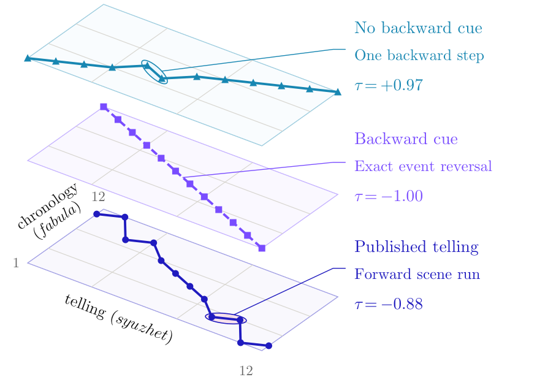
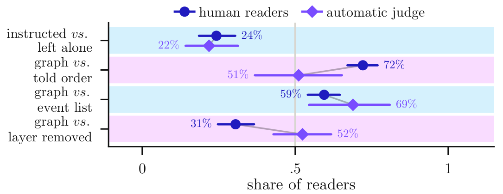
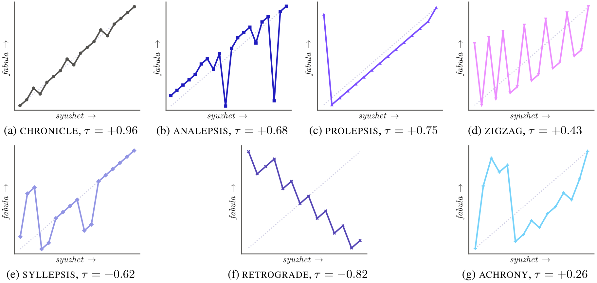
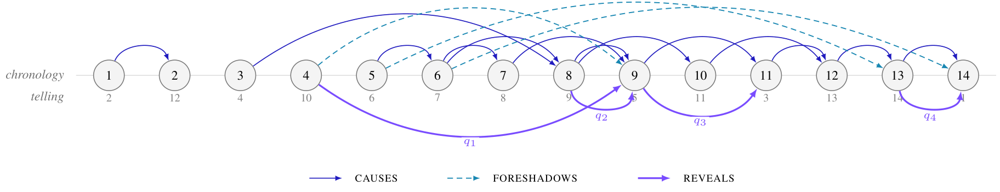
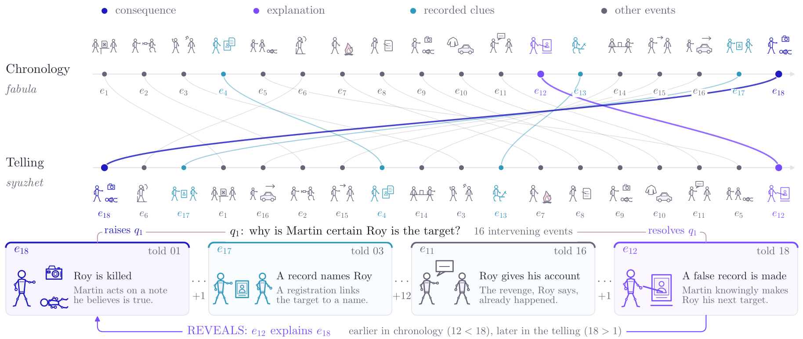
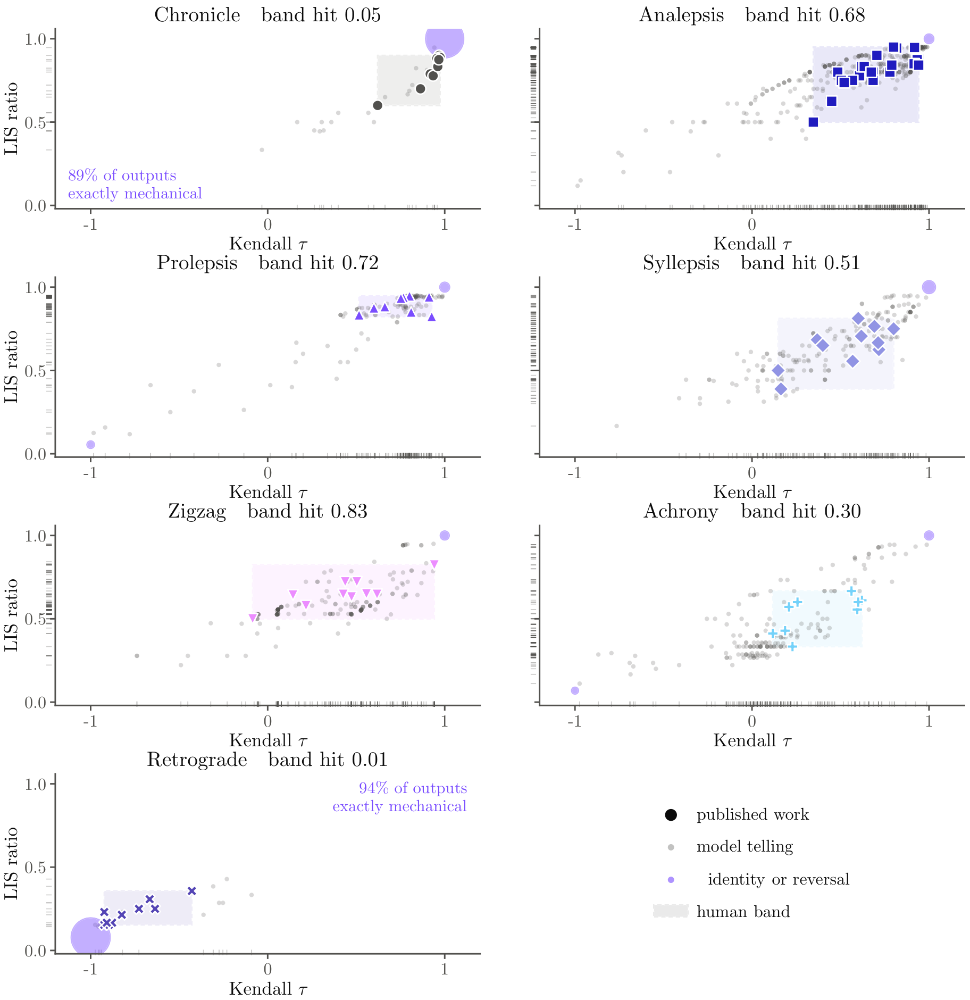

<div align="center">

# Can LLMs Tell Stories Out of Order?

### A Corpus and Benchmark for Nonlinear Narrative Generation

<a href="https://arxiv.org/abs/2610.21468"></a>
<a href="https://nonlinear-narrative.github.io/"></a>
<a href="#the-corpus"></a>
<a href="#the-benchmark"></a>
<a href="LICENSE"></a>
<a href="https://hits.sh/github.com/Starscream-11813/LLM-nonlinear-storytelling/"></a>

</div>

This repository contains the annotated corpus, code, stored model outputs, and human-evaluation responses for the paper [**Can LLMs Tell Stories Out of Order? A Corpus and Benchmark for Nonlinear Narrative Generation**](https://arxiv.org/abs/2610.21468).

## Overview

Every story has two orders: **fabula**, the order in which events happen, and **syuzhet**, the order in which they are told. The paper studies whether language models can control the difference between them, and whether that control produces stories people prefer to read.

We annotate **83 published works** with paired event orders and story graphs, evaluate **19 LLMs** across ordering, reconstruction, classification, and prose generation, and compare automated evaluation with **3,528 blind judgments from 71 readers**. Models can follow instructions to reorder events, but their instructed nonlinear stories often lose to their default, more chronological tellings.

<p align="center">
  <a href="images/ordering-example.png">
    
  </a>
  <br>
  <sub><strong>Reordering is only part of nonlinear storytelling.</strong> A backward cue produces exact event reversal, while the published telling preserves forward runs within scenes. Cropped from <a href="https://arxiv.org/pdf/2610.21468#page=1">Figure 1 of the paper</a>.</sub>
</p>

## Contents

- [Key findings](#key-findings)
- [The corpus](#the-corpus)
- [The benchmark](#the-benchmark)
- [Repository guide](#repository-guide)
- [Using this repository](#using-this-repository)
- [Human evaluation](#human-evaluation)
- [Scope and interpretation](#scope-and-interpretation)
- [Authors](#authors)
- [Citation](#citation)
- [License](#license)

## Key findings

| Finding | Evidence from the paper |
|:---|:---|
| **Default tellings stay closer to chronology.** | All 19 models are more chronological on average than the selected published works. Pooled Kendall's tau is **0.638**, compared with **0.456** for the corpus. |
| **A named structure gives only partial control.** | Cued tellings fall within the requested category's corpus-derived structural band **47.9%** of the time. Band hit measures resemblance in the structural plane, not prose quality or complete compliance with a shape. |
| **Reconstruction scores need a no-story control.** | Three strong solvers reach **tau = 0.849** when given event sentences without the telling order, versus **0.884** with it. Much of the chronology is recoverable without reading the telling. |
| **Readers prefer the default telling.** | Free tellings beat instructed tellings in **75.8%** of decisive better-story judgments (**200/264**). Readers find the instructed version harder to follow in **80.7%** of decisive difficulty judgments (**197/244**). |
| **A graph can beat a supplied order, but the judge misses the preference.** | Readers prefer full-graph stories to stories constrained to the published telling order in **72.1%** of decisive judgments (**181/251**); the length-adjusted rate is **70.7%**. The automated judge detects no preference on this comparison. |

Reader percentages exclude ties and refer to the prose study's **14 works**, not the full 83-work corpus. The reconstruction comparison uses three solvers and is not a separate no-story control for every benchmark model. See [Sections 5.1, 5.2, and 5.5](https://arxiv.org/pdf/2610.21468) for the complete analyses.

<p align="center">
  <a href="images/reader-preferences.png">
    
  </a>
  <br>
  <sub><strong>Readers and the judge do not always agree.</strong> These are unadjusted preference rates. The graph's advantage over an event list disappears after length adjustment, and removing one graph layer can help readers. Cropped from <a href="https://arxiv.org/pdf/2610.21468#page=8">Figure 5 of the paper</a>.</sub>
</p>

## The corpus

The corpus contains **73 nonlinear works and 10 predominantly chronological controls**. Each work has one hand-written list of events, read in chronological order or in the work's telling order. Both orders therefore describe exactly the same event set: the relationship is a **permutation by construction**.

| Annotation | Count |
|:---|---:|
| Published works | 83: 71 films, 7 novels, 2 plays, 2 musicals, 1 short story |
| Events | 1,433, with 12-20 per work |
| Scenes | 1,221 |
| Characters | 857 |
| Story graphs | 83 |
| Typed graph edges | 3,478 |
| Reader-question threads | 657 |
| Character and reader knowledge claims | 2,504 |

### Seven narrative shapes

Each work has a label and a short justification in its anonymized annotation. Labels describe how the scene order departs from chronology.

| Category | Works | Telling pattern |
|:---|---:|:---|
| `CHRONICLE` | 10 | Moves forward; scenes presented as simultaneous may arrive in either order |
| `ANALEPSIS` | 22 | A dominant narrative present with flashbacks to earlier events |
| `PROLEPSIS` | 10 | A dominant narrative present with flash-forwards to later events |
| `ZIGZAG` | 10 | Two bands alternate regularly, each internally monotone |
| `SYLLEPSIS` | 11 | Blocks organized by a non-temporal principle, such as character, place, or theme |
| `RETROGRADE` | 10 | Runs backward without returning to a dominant narrative present |
| `ACHRONY` | 10 | No other category's ordering rule applies, although chronology remains recoverable |

The story curves below make these patterns visible. Moving from left to right follows the telling; moving upward follows chronology. Flashbacks interrupt a dominant forward trajectory, ZIGZAG alternates between periods, and SYLLEPSIS groups events into blocks. These are examples from published works, with the variations that occur in actual tellings.

<p align="center">
  <a href="images/narrative-shapes.png">
    
  </a>
  <br>
  <sub><strong>Seven narrative shapes in the corpus.</strong> Each panel shows the work nearest its category's median in the (tau, LIS) plane. The horizontal axis is telling position and the vertical axis is chronological position; the dotted diagonal is strict chronology. Colors match the human-band plots below. Cropped from <a href="https://arxiv.org/pdf/2610.21468#page=16">Figure 6 in Appendix A of the paper</a>.</sub>
</p>

The RETROGRADE curve is especially important: published reverse chronology descends by scene while retaining short forward runs inside each scene. Reversing every event produces a different pattern. This distinction helps explain the low RETROGRADE band-hit rate discussed under [human bands and structural control](#human-bands-and-structural-control).

### Story graphs

The event list records what happens. The graph adds **causal dependencies, world state, character and reader knowledge, grounding, and questions raised and resolved**. Its four edge types are `CAUSES`, `FORESHADOWS`, `REVEALS`, and `SHARES`.

A `REVEALS` edge links an explanation to the event it explains: the explanation comes earlier in chronology but later in the telling. This makes withheld information explicit rather than treating any backward jump as a revelation.

<p align="center">
  <a href="images/story-graph.png">
    
  </a>
  <br>
  <sub><strong>A story graph across both event orders.</strong> This example is S60, a musical labeled ZIGZAG. Nodes run in chronological order, with telling positions underneath. Solid blue CAUSES and dashed cyan FORESHADOWS arcs run above the nodes; violet REVEALS arcs below connect explanations to the earlier-told events they explain, labeled by reader question. SHARES edges are omitted. Cropped from <a href="https://arxiv.org/pdf/2610.21468#page=4">Figure 3 of the paper</a>.</sub>
</p>

S60 opens with the actress finding the flat empty: chronological event 14 is told first. The farewell letter, event 13, is told last. The `REVEALS` edge from 13 to 14 therefore answers the opening question about the empty flat only at the end. The graph records this relationship alongside causal dependencies; its full annotation also includes world state and character knowledge. The position labels in this illustration are withheld from graph-generation prompts.

<p align="center">
  <a href="images/story-graph-reveal.png">
    
  </a>
  <br>
  <sub><strong>The same events, two orders.</strong> An explanation precedes its consequence in chronology but arrives last in the telling, resolving the question raised at the opening. Cropped from <a href="https://arxiv.org/pdf/2610.21468#page=2">Figure 2 of the paper</a>.</sub>
</p>

### Files and anonymization

The JSON annotations are the source of truth; the CSVs are validated build artifacts.

| Path | Contents |
|:---|:---|
| [`dataset/movies/`](dataset/movies/) | 83 source annotations with titles and release years |
| [`dataset/movies_anon/`](dataset/movies_anon/) | 83 anonymized annotations, `S01`-`S83`, with gold story graphs |
| [`dataset/dataset.csv`](dataset/dataset.csv) | Titled corpus |
| [`dataset/dataset_anonymized.csv`](dataset/dataset_anonymized.csv) | Anonymized corpus used to construct model inputs |
| [`dataset/anonymization_key.csv`](dataset/anonymization_key.csv) | Mapping from story IDs to original titles and years |

Anonymization replaces names, places, organizations, quotations, distinctive props, and other surface identifiers while preserving event counts, order, scene structure, and causal relations. It reduces recall cues but cannot hide a distinctive premise. The titled corpus, title key, and order metadata are evaluation references, not inputs to the main benchmark.

Read an anonymized work from the repository root:

```python
import csv
import json

with open("dataset/dataset_anonymized.csv", encoding="utf-8", newline="") as f:
    row = next(csv.DictReader(f))

events = row["fabula"].split(" | ")
told_order = [int(i) for i in row["syuzhet_order"].split()]
telling = [events[i - 1] for i in told_order]
graph = json.loads(row["story_graph"])

assert telling == row["syuzhet"].split(" | ")
```

<details>
<summary><strong>Annotation schema and validation</strong></summary>

Source JSONs contain `title`, `release_year`, `genre`, `source`, `events_chronological`, `syuzhet_order`, `event_scenes`, `syuzhet_notes`, and `fabula_notes`. Anonymized JSONs replace the identifying fields with `story_id` and `source_index`, and add `nonlinear_category`, its justification, and `story_graph`.

The CSVs expose both event-text columns (`fabula`, `syuzhet`), both order columns (`fabula_order`, `syuzhet_order`), both scene-order columns, `tau`, `lis`, and annotation notes. The anonymized CSV also includes `nonlinear_category` and the graph as JSON. Event indices are 1-based chronological positions, so `fabula_order` is always `1 2 ... n`.

Scenes are contiguous in both orders. Several events may share a scene; collapsing repeated adjacent scene IDs gives a scene-level permutation.

A graph contains `characters`, `events`, and `edges`. Node `ei` corresponds to chronological event `i`:

| Event field | Contents |
|:---|:---|
| `core`, `content` | Subject-verb-object triple and an expanded description |
| `participants`, `location` | Who is present and where |
| `pre`, `post` | World-state flags before and after the event |
| `learns` | Propositions learned by each character and by the reader |
| `raises`, `resolves`, `questions` | Reader-question IDs and their text |
| `story_time` | Chronological event index in the gold annotation |

The build checks permutations, scene contiguity, field structure, anonymization leaks, and agreement between source and anonymized annotations. It also replays world-state flags chronologically, checks that questions are raised and resolved exactly once, and enforces graph-edge constraints. A separate verifier reconstructs the orders from the CSV prose, recomputes tau and LIS independently, and checks both CSVs against each other.

</details>

## The benchmark

### Tasks and models

The main benchmark evaluates **19 models: 9 closed and 10 open-weight**, queried through OpenRouter. Exact identifiers and roster labels are in [`experiments/models.json`](experiments/models.json); four models also have high-reasoning-effort runs listed in [`models_effort.json`](experiments/models_effort.json).

| Task | Input | Output |
|:---|:---|:---|
| `T1_transpose_cued` | Chronological events and a named shape | A telling order |
| `T2_transpose_free` | Chronological events | A freely chosen telling order |
| `T3_reconstruct` | Events in the published telling order | The chronology |
| `T4_classify` | Events in the published telling order | One of the seven shape labels |
| `T5_prose_cued` / `T5b_prose_free` | Chronological events, with or without a named shape | A prose story |

The main prompts omit story identifiers, titles, notes, scene and order metadata, and graphs. T3 and T4 receive events in the gold telling order because reading that order is the task. Ordering and classification use temperature 0, low reasoning effort, and an 8,000-token limit; prose uses temperature 0.7 and a 4,000-token limit. The prose experiments use **14 works, two per category**, and a smaller model subset.

### Graph scaffolding and further experiments

The graph arm asks for a 550-750 word story under eight conditions:

| Condition | Information supplied beyond events and the requested shape |
|:---|:---|
| `G0_fabula_only` | None |
| `G1_full_graph` | Full narrative graph, with positional metadata removed |
| `G2_order_only` | Gold telling order, an oracle control |
| `A1_no_causal` | G1 without `CAUSES` and `FORESHADOWS` |
| `A2_no_state` | G1 without `pre` and `post` |
| `A3_no_epistemic` | G1 without `learns` |
| `A4_no_questions` | G1 without questions and `REVEALS` |
| `A5_no_grounding` | G1 without participants and location |

Graph prompts strip `story_time` and `told_at`, but semantic constraints such as `REVEALS` still partly constrain telling order. G2 therefore supplies an explicit order control. The ablation prompts keep the same instructions apart from the removed layer and its explanation.

Two further experiments test what the evaluation can recover:

- **Retrospective coherence gain (RCG):** compare a solver's reconstruction from a pre-reveal prefix and from the full story, alongside a cause-guessing task and a no-text baseline. Interpret RCG with the qualifications in the paper's Section 5.4 and Appendix J.
- **Recoverability:** cross shuffled versus gold telling order with original versus de-dated event sentences. The four cells are `R0_orig_notext`, `R1_orig_told`, `R2_dedated_notext`, and `R3_dedated_told`.

### Structural and prose evaluation

| Measure | Interpretation |
|:---|:---|
| Kendall's tau | Agreement of a telling with chronology: +1 is chronological, -1 is exact reversal |
| LIS ratio | Longest increasing subsequence length divided by the event count |
| Band hit | Whether a telling's `(tau, LIS)` falls inside the corpus-derived range for the requested category |
| Gold-order agreement | Kendall's tau against the published telling |
| Scene contiguity | Fraction of gold scenes kept in one unbroken run |
| Reconstruction exact match | Whether the entire recovered chronology is correct |

For prose, a judge aligns the generated text back to the event list before structural scoring. Additional instruments assess psychological depth and blind pairwise preferences. A second judge independently aligns a subsample; agreement is reported in [`interjudge.json`](experiments/results/interjudge.json).

Reference rows include identity, reverse, and random baselines, plus `[reference] human (gold)`, which means the annotated published telling. It is not newly collected human prose. Exclude baseline/reference rows and names ending in `[high]` when pooling the 19-model main cohort. Common-subset tables repeat comparisons on stories answered by every model to account for uneven refusals.

### Human bands and structural control

For each category, its **human band** is the rectangle bounded by the minimum and maximum tau and LIS values of its published tellings. A model output counts as a band hit only when both coordinates fall inside that rectangle. The reference comes from the corpus annotations; it is separate from the reader-preference study.

<p align="center">
  <a href="images/human-band-hit.png">
    
  </a>
  <br>
  <sub><strong>Where cued model tellings fall relative to published works.</strong> Large colored marks show corpus works, small gray dots show valid cued outputs, and shaded rectangles with dashed boundaries show the human bands. Violet circles combine exact identities or reversals, with area proportional to their share. Ticks along the axes show marginal distributions. Panel titles give rounded band-hit rates. Cropped from <a href="https://arxiv.org/pdf/2610.21468#page=22">Figure 8 in Appendix E of the paper</a>.</sub>
</p>

The two most pronounced mismatches are **CHRONICLE (5.3% band hit)** and **RETROGRADE (1.1%)**. Models return the exact identity in **88.9%** of CHRONICLE outputs and the exact event reversal in **93.6%** of RETROGRADE outputs. The published works stop short of those extremes: chronicles can contain simultaneous events, and retrograde tellings preserve forward order within scenes. Because the prompts express the shapes as rules over event ranks without marking scenes or simultaneity, these failures expose a gap between literal instruction-following and the scene-level patterns in the corpus. Whether explicit scene markers close that gap remains untested.

Band hit also has limits in the better-performing categories. **ZIGZAG reaches 82.6%**, but two coordinates cannot establish whether a telling alternates regularly between periods. Different permutations can share tau and LIS, so the plots measure structural resemblance without proving the requested shape or the quality of the resulting prose. See [Section 5.1.2 and Appendix E](https://arxiv.org/pdf/2610.21468) for the category breakdowns and scene-level analysis.

## Repository guide

| Path | Contents |
|:---|:---|
| [`dataset/`](dataset/) | Source and anonymized annotations, corpus CSVs, builders, and independent verification |
| [`experiments/tasks.py`](experiments/tasks.py), [`metrics.py`](experiments/metrics.py) | Prompts, strict parsers, and structural measures |
| [`experiments/runner.py`](experiments/runner.py) | Resumable API generation runner |
| [`experiments/raw/`](experiments/raw/) | 144 JSONL files containing stored generation and judging records |
| [`experiments/results/`](experiments/results/) | 49 derived result files rebuilt by the offline scoring scripts |
| [`humaneval/responses2.csv`](humaneval/responses2.csv) | Human-evaluation responses in long format |
| [`images/`](images/) | Six cropped figures from the arXiv paper used in this README |

### Experiment and artifact map

| Stage | Offline script | Main outputs in `experiments/results/` |
|:---|:---|:---|
| T1-T4 and calibration | [`score.py`](experiments/score.py) | `table_T1`-`table_T4`, `per_row.csv`, `calibration.json`, `classifier_calibration.csv` |
| Category, cost, effort, common subsets | [`analysis.py`](experiments/analysis.py) | `breakdown_*.csv`, `common_subset_*.csv` |
| Prose and judge agreement | [`score_prose.py`](experiments/score_prose.py) | `table_T5_*.csv`, `prose_*_rows.csv`, `interjudge.json` |
| Graph conditions and ablations | [`score_grapharm.py`](experiments/score_grapharm.py) | `grapharm_*.csv` |
| Retrospective coherence | [`score_rcg.py`](experiments/score_rcg.py) | `rcg_*.csv` |
| Recoverability | [`score_recover.py`](experiments/score_recover.py) | `recover_*.csv` |

<details>
<summary><strong>Stored-record formats</strong></summary>

Each raw file contains one JSON object per line. Generation records include story, task, model, category, decoding settings, token counts, cost, status, and parsed output. The runner's `raw` field retains up to 8,000 characters of the reply; parsed prose is stored in full in `text`.

| Filename pattern | Contents |
|:---|:---|
| `<model>__<task>.jsonl` | Main benchmark or graph-arm generation; `__r2` marks a second replicate |
| `judge_<judge>__<instrument>.jsonl` | Prose judging |
| `gjudge_<judge>__<instrument>.jsonl` | Graph-arm alignment, depth ratings, and pairwise judging |
| `rcg_<solver>.jsonl`, `rcg_none_<solver>.jsonl` | RCG and its no-text baseline |
| `recover.jsonl` | Recoverability experiment |

`parse_mode` distinguishes strict outputs from permutations extracted from wrapper text. A reply without an exact permutation is recorded as failed and is not repaired. `skipped` RCG records include stories without a designated reveal or with fewer than three events before it.

</details>

## Using this repository

### Rebuild the derived results offline

Use **Python 3.10 or newer**. The corpus and API scripts use the standard library; scoring additionally requires pandas. Run these commands from the repository root:

```bash
git clone https://github.com/Starscream-11813/LLM-nonlinear-storytelling.git
cd LLM-nonlinear-storytelling
python -m pip install -r requirements.txt

# Validate the corpus without rewriting it.
python dataset/build_dataset.py --check
python dataset/build_anonymized.py --check
python dataset/verify_dataset.py

# Rebuild the 49 derived result files from stored replies.
python experiments/score.py
python experiments/analysis.py
python experiments/score_prose.py
python experiments/score_grapharm.py
python experiments/score_rcg.py
python experiments/score_recover.py
```

No API key or network access is needed for validation or scoring after installing dependencies. The six scoring commands regenerate all **49 files** in `experiments/results/`, matching the checked-in contents after normalizing line endings. `score_rcg.py` also writes an ignored plot at `dataset/figures/rcg_plane.svg`. Windows may produce CRLF rather than LF line endings.

These commands rebuild the released automated result files. Human responses are provided separately; the repository does not include scripts to regenerate the paper's human-evaluation analyses.

### Generate new model outputs

The generation and judging scripts call OpenRouter and incur provider charges. Set `OPENROUTER_API_KEY` in your shell using `export OPENROUTER_API_KEY="your-key"` in Bash or `$env:OPENROUTER_API_KEY = "your-key"` in PowerShell.

For fresh generations, use a separate checkout and move its `experiments/raw/` directory aside before running; the runner creates a new directory. For example:

```bash
python experiments/runner.py --tasks T1_transpose_cued --only "Claude Opus 5"
```

The runner skips successful cells already in `raw/` and retries failed cells. Useful options include `--tasks`, `--only`, `--per-category`, and `--replicates`. Other API entry points are `judge.py`, `judge_grapharm.py`, `rcg.py`, `rcg_baseline.py`, `recover.py`, and `dedate.py` under `experiments/`.

Hosted model snapshots can change, and prose is sampled at temperature 0.7, so fresh generations need not match the stored outputs.

## Human evaluation

[`humaneval/responses2.csv`](humaneval/responses2.csv) contains **13,823 recorded values from 71 participants**, covering **14 stories and 11 generator models**. Participants saw stories without generation-condition labels. The paper's **3,528 blind judgments** are distinct from the CSV row count: each comparison records several values.

| Block | Recorded information |
|:---|:---|
| `background` | Fiction-reading habits, writing experience, and viewport width |
| `literacy` | Three questions about a published work's story-curve diagram |
| `pairwise` | Better story, harder to follow, better ending, confidence, and optional reasoning |
| `single` | Reading time, five Psychological Depth Scale items, chronology reconstruction, question status, consistency checks, and authorship guess |

Rows identify the participant, item, story, model, category, displayed conditions, word counts, measure, value, and response time where recorded. Pairwise `A` and `B` mean the left and right stories, so interpret them through `condition_left` and `condition_right`. Measures ending in `_repeat` record a hidden comparison repeated with the sides swapped. All stories shown in the authorship-guess task were machine-written.

The full instruments and reader-analysis methods appear in [Section 5.5 and Appendices F and M of the paper](https://arxiv.org/pdf/2610.21468).

## Scope and interpretation

- The corpus deliberately selects nonlinear works and includes chronological controls. Models receive chronological input in the generation tasks, so default chronology can reflect input-order copying as well as a preference for chronological telling.
- Anonymization removes surface identifiers, but distinctive plots may remain recognizable. The recoverability control cannot separate inference from prior knowledge of a work.
- Structural measures describe ordering. They do not establish literary quality, suspense, or reader understanding, and an LLM judge can miss preferences readers express.
- Graph versus supplied-order comparisons also differ in ordering freedom and prompt content. The graph's raw advantage over a bare event list disappears after length adjustment. Benefits from removing graph layers are concentrated in one generator.
- Prose and reader results cover 14 works and model subsets. Generation logs date from **6-10 August 2026**, and the reader study ran **8-17 September 2026**; rankings describe these experimental snapshots.

## Authors

**Syed Rifat Raiyan**<sup>1,*</sup>, **Md. Tariquzzaman**<sup>1,*</sup>, **Md Farhan Ishmam**<sup>2,&dagger;</sup>, **Tenghao Huang**<sup>3</sup>

<sup>1</sup> Islamic University of Technology, Bangladesh<br>
<sup>2</sup> University of Utah, USA<br>
<sup>3</sup> University of Southern California, USA

<sup>*</sup> Equal contribution. <sup>&dagger;</sup> Corresponding author.

Contact: `rifatraiyan@iut-dhaka.edu`, `tariquzzaman@iut-dhaka.edu`, `farhan.ishmam@utah.edu`, `tenghaoh@usc.edu`.

## Citation

If you use the corpus, benchmark, or released results, please cite:

```bibtex
@misc{raiyan2026llmstellstoriesorder,
  title         = {Can {LLMs} Tell Stories Out of Order? A Corpus and Benchmark
                   for Nonlinear Narrative Generation},
  author        = {Syed Rifat Raiyan and Md. Tariquzzaman and
                   Md Farhan Ishmam and Tenghao Huang},
  year          = {2026},
  eprint        = {2610.21468},
  archivePrefix = {arXiv},
  primaryClass  = {cs.CL},
  url           = {https://arxiv.org/abs/2610.21468}
}
```

## License

This repository is released under the [MIT License](LICENSE). The arXiv manuscript's deposit license is listed separately on its [arXiv record](https://arxiv.org/abs/2610.21468).
